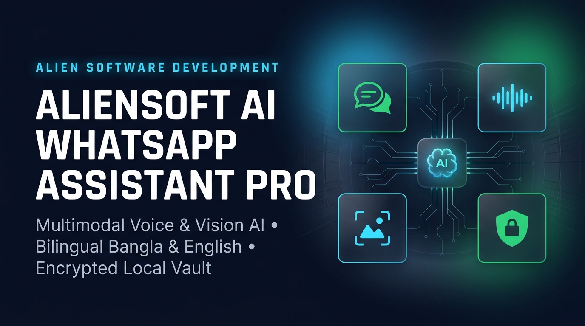

<div align="center">



# Aliensoft AI WhatsApp Assistant Pro — Public Releases

**Native Windows 10/11 (x64) AI-Powered WhatsApp Automation & Smart Customer Support Suite**  
Built by **[Alien Software Development](https://aliensoftwaredevelopment.com)** · Dhaka, Bangladesh

[](https://github.com/alien-software-development/Aliensoft-AI-WhatsApp-Assistant-Releases/releases/latest)
[-0284C7?style=for-the-badge)](#quick-start-offline-portable)
[](#licensing--clean-install-guarantee)

</div>

---

## Official Public Distribution Repository

This public repository hosts **ready-to-run Windows x64 Offline Portable packages and installers** along with release checksums (`SHA-256`) and security advisories. Source code is maintained in a private Alien Software Development repository.

> **Download the latest release here:**  
> **[Releases Page -> Latest Build](https://github.com/alien-software-development/Aliensoft-AI-WhatsApp-Assistant-Releases/releases/latest)**

---

## Key Capabilities

- **True Voice Note & Image AI Understanding**  
  Automatically downloads, transcribes, analyzes, and answers incoming WhatsApp voice notes (`.ogg`/`.opus`/`.m4a`/`.mp3`) and product/receipt images using your configured AI provider (**Gemini**, **OpenAI**, or **DeepSeek**) grounded in your catalog, services, FAQs, and conversation history.
- **Bilingual Bangla, Banglish & English Support**  
  Automatically matches the customer's reply language across Bangla script, transliterated Banglish, and English.
- **200+ Built-In Automation Rules**  
  First-launch setup automatically initializes **200 ready-to-use automation rules** (`[AR-001]`–`[AR-200]`) covering pricing, orders, delivery, payments, warranty, and AI-first routing.
- **Dual WhatsApp Connectivity**  
  Connect via **QR Web Gateway** (with bundled self-contained portable runtime) or the **Official Meta WhatsApp Cloud API**.
- **Human-in-the-Loop Approval Inbox**  
  Choose **Automatic**, **Hybrid**, or **Manual** approval per rule or confidence threshold.
- **Zero-Dependency Offline Portable Package**  
  Includes the self-contained Windows runtime and bridge runtime—no separate `.NET` or `Node.js` installation needed on the target Windows PC.
- **Automatic Update Notifications**  
  Built-in updater checks this public repository (`alien-software-development/Aliensoft-AI-WhatsApp-Assistant-Releases`) and verifies `SHA-256` checksums before applying updates.

---

## Quick Start (Offline Portable)

1. Download `Aliensoft-AI-WhatsApp-Assistant-Offline-Portable-win-x64.zip` (and optional `.sha256`) from **[Releases](https://github.com/alien-software-development/Aliensoft-AI-WhatsApp-Assistant-Releases/releases/latest)**.
2. *(Optional)* Verify integrity in PowerShell:
   ```powershell
   Get-FileHash .\Aliensoft-AI-WhatsApp-Assistant-Offline-Portable-win-x64.zip -Algorithm SHA256
   ```
   Compare the hash with the `.zip.sha256` file included in the release.
3. Right-click the `.zip` -> **Extract All...** into a folder such as `C:\Aliensoft\WhatsAppAssistant\`.
4. Launch `Aliensoft.Assistant.Desktop.exe`.
5. Configure your own **AI Provider API key** (Gemini / OpenAI / DeepSeek) and connect WhatsApp inside **WhatsApp Accounts & QR**.

---

## Licensing & Clean-Install Guarantee

- **100% Clean Package**: Every release passes an automated pre-package sanitizer that strips all developer databases, inbox conversations, WhatsApp `.auth` sessions, logs, API keys, and private license files.
- **Fresh Automatic Initialization**: On first launch on your PC, the app creates your private local data store with **200 preset automation rules** and an automatic **30-day free trial** (`%LOCALAPPDATA%\Aliensoft\WhatsAppAssistant\`).
- **Privacy**: Your API keys, customer inbox data, and encrypted product images stay strictly on your local Windows machine under DPAPI encryption.

---

## Security & Support

- See [SECURITY.md](SECURITY.md) for security architecture and responsible disclosure details.
- Website: [aliensoftwaredevelopment.com](https://aliensoftwaredevelopment.com)
- Direct WhatsApp Support & Activation: `+880 1710-978997`
